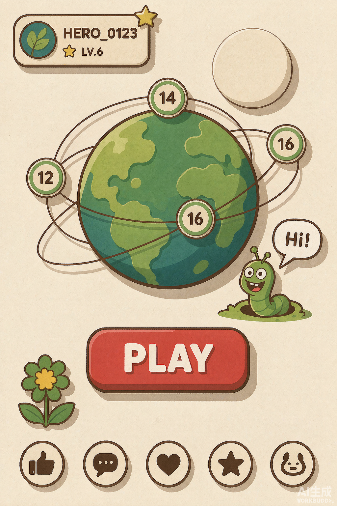
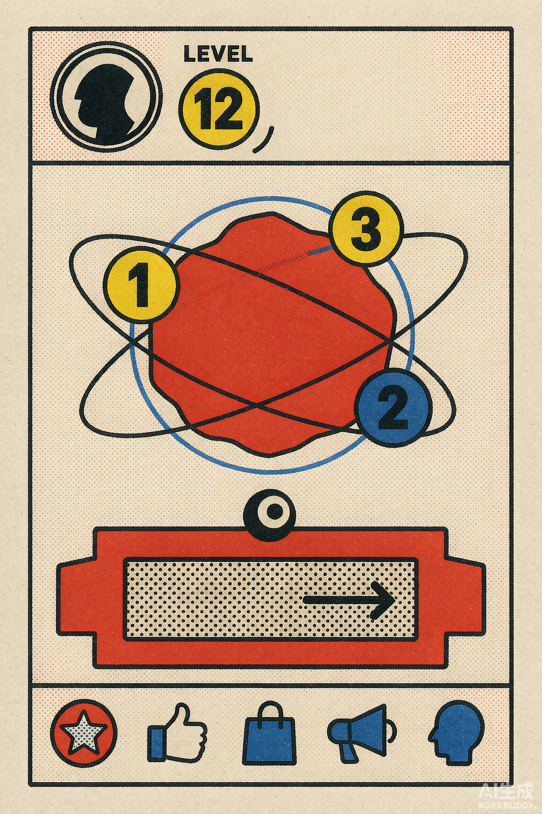
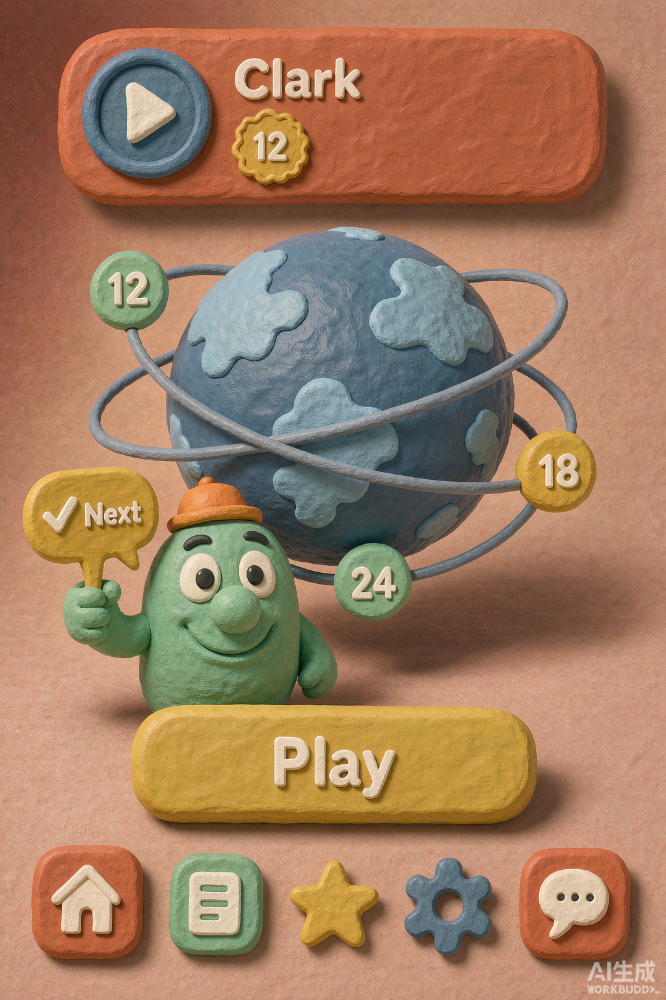

# 23 · UI 风格方案（三选一）

> 状态：**待拍板**。本文只做风格选型，不覆盖已落地的 `22-UI设计系统.md`。
> 用户选定方向后，按 §6 的落地计划执行，并把结果写回 22。

---

## 1. 先诊断：现在这套为什么"不太好看"

现行「糖果夜空」不是画错了，是**审美坐标选错了**。它的每个特征单独看都成立，合起来是标准的"AI 通用好看"，没有性格：

| 症状 | 具体表现 | 为什么是问题 |
|---|---|---|
| 紫色渐变天空 | `#2E2078 → #1B1252 → #120C3A` | 这是 AI 出图最常见的一档背景，看多了就等于没有背景 |
| 万物同一个材质 | 40+ 处调用 `jelly()` / `glass()`：厚底边 + 竖向渐变 + 顶部高光 + 白边光 | 所有东西一个配方刷满全屏 → **没有材质对比就没有层次**，按钮和卡片和节点同一个手感，读起来是塑料 |
| 发光泛滥 | `halo()` 用在地图节点、吉祥物、星球、头像、按钮…… | 到处发光 = 没有焦点。发光应该是"只有一个东西在发光" |
| 没有造型语言 | 全屏只有"圆角矩形"和"圆形"两种形 | 没有任何一个能让人记住的**轮廓**。卡通感 90% 来自造型，不是配色 |
| 7 色平均铺开 | 蓝/绿/橙/粉/紫/金/珊瑚，每个都在用 | 颜色没有主次。应当是「一个大面积主色 + 两个小面积尖锐强调」 |
| 零质感 | 纯矢量渐变，没有纹理、没有噪点、没有印刷感 | 这是"塑料感"的根源。真实材质一定有瑕疵：噪点、纸纹、套印偏差 |
| 字体是系统字 | PingFang SC 800 | 中文小游戏里系统字最省事也最没性格；但换字体在微信端有包体和加载成本（见 §3） |

**一句话**：现在是"配色统一的扁平 UI 加了果冻高光"，不是"有材质、有造型语言的卡通世界"。

---

## 2. 三套候选方向

三套都不是"换个配色"，而是**换一套材质语言**。样片见 `风格样片/`（AI 生成，仅表达方向，不是最终实现）。

### 2.A 剪纸星球 / Paper Planet



| 项 | 规格 |
|---|---|
| 一句话 | 所有元素都是"剪下来贴上去的纸片"，每片底下有一层硬投影 |
| 底色 | 米黄纸 `#F4EBD8`（**浅底**，与现在相反） |
| 色板 | 番茄红 `#E8503A` / 芥末黄 `#F2B33D` / 苔绿 `#5E8C4A` / 牛仔蓝 `#3D6E9E` / 奶油白 `#FFF9EC` / 深棕墨 `#3B2A1F` |
| 描边 | 深棕墨 4px 实心，**圆角很小**（r ≈ 4–8），不用大圆角 |
| 体积 | 不用渐变。靠"硬投影（偏移 6–10px、无模糊）+ 一层亮面纸 + 一层暗面纸"叠出层数 |
| 记忆点 | **撕边**：纸片轮廓有 2–3px 的手撕毛边（固定 seed 的多边形抖动），一眼能认出是"手工做的" |
| 字体 | 标题用粗描边 + 字重 900，靠描边而不靠字体做性格 |
| Canvas 落地度 | ★★★★★ 95%。硬投影就是同一形状偏移再画一遍，撕边是多边形抖动，零 API 依赖 |
| 风险 | 浅底在强光下不如深底醒目（可接受，休闲游戏本来偏亮）；配色偏"自然/复古"，如果想要更活泼需要把番茄红和芥末黄的比例拉高 |

**深色变体（皮影戏 / Shadow Puppet）**：同一套造型语言，底换成深蓝纸 `#1D2B4F`，纸片改成"透光的暖黄/橘"，投影几乎全黑。夜里开灯看皮影的感觉。**同一套代码只换色板即可**，等于这一个方向覆盖了「明亮」和「深色」两种诉求。

---

### 2.B 三色油印 / Riso Press



| 项 | 规格 |
|---|---|
| 一句话 | 只准用三种油墨印在米白纸上，网点 + 套印错位 |
| 底色 | 米白 `#F7F1E3` |
| 色板 | 番茄红 `#FF4D2E` / 靛蓝 `#1B4B8F` / 柠檬黄 `#FFCE3A` + 墨黑 `#1C1A1A`（**只有 4 个颜色**） |
| 描边 | 纯黑 5px，全部图形统一 |
| 材质 | 45° halftone 网点（`createPattern`，一次生成反复贴）+ 3px 套印错位（同一图形画两次、差 3px）+ 纸纹噪点 |
| 记忆点 | **套印错位**：色块故意对不齐，这是 risograph 的灵魂，市面上没有一个连连看这么做 |
| Canvas 落地度 | ★★★★☆ 85%。网点和噪点都能用 `createPattern`，性能好 |
| 风险 | **文字压在网点上可读性差**（样片里已经能看出来），必须给文字留纯色底；风格偏"设计圈高级"，普通玩家可能觉得"怪/旧"；只有 4 色，功能色（成功/失败/警告）不好区分 |

---

### 2.C 黏土工坊 / Clay Studio



| 项 | 规格 |
|---|---|
| 一句话 | 所有东西都是橡皮泥捏的，定格动画的一帧 |
| 底色 | 陶土色渐变 `#E9D5C0 → #D8B99C` + 暗角 |
| 色板 | 陶土橙 `#E07A4F` / 奶油 `#F6E7D3` / 薄荷 `#7FBFA0` / 芥末 `#E0B33C` / 灰蓝 `#6C8AA6` |
| 体积 | **硬边色块代替渐变**：一个形 = 底色块 + 上缘亮色块 + 下缘暗色块，三块拼接 |
| 材质 | 指纹/指纹纹理、工具压痕、表面微噪 |
| 记忆点 | 手工捏制的不规则轮廓 + 硬边体积，比任何渐变都"贵" |
| Canvas 落地度 | ★★☆☆☆ **60%，打折最狠** |
| 风险 | **样片效果无法用 Canvas 复刻**。那种指纹纹理、柔和的棚拍光照，需要法线贴图或 3D 渲染。Canvas 只能做到"圆润渐变 + 硬阴影"，最终会掉回"果冻按钮"那个坑——而这正是现在被否掉的东西。除非上 3D 预渲染位图（包体大、微信端加载慢） |

---

## 3. 技术约束（决定了"打折"多少）

**必须在 Canvas2D 里手绘**，不能上 DOM/CSS，也不能依赖图像处理：

| 能力 | 可用性 | 影响 |
|---|---|---|
| 硬投影（偏移 + 无模糊） | ✅ 完全可用，零成本 | **剪纸风的根基，白送** |
| 粗描边 / 多边形抖动 | ✅ 完全可用 | 撕边可实现且确定（固定 seed） |
| 平面色块 | ✅ 完全可用 | 剪纸/印刷风都是平面色，天然契合 |
| `createPattern` 平铺纹理 | ✅ 可用，性能好 | 网点、纸纹、噪点都可以，一次生成反复贴 |
| 高斯模糊 / `filter: blur` | ❌ 慢，微信端逐像素 | 柔光、黏土的柔和光照做不了 |
| 柔和渐变体积 | ⚠️ 能做但就是"塑料感" | 现在的果冻按钮就死在这 |
| 自定义字体 | ⚠️ 需 `wx.loadFont` 加载 ttf，包体 +1~3MB | 三套方案都建议**不换字体**，靠描边和字重做性格 |
| 3D / 法线贴图 | ❌ | 黏土风真实质感无法实现 |

**结论**：`A 剪纸` 的打折最小（95%），`B 油印` 中等（85%），`C 黏土` 最大（60%，且会退回被否掉的观感）。

---

## 4. 推荐：A · 剪纸星球

**理由**（按权重排序）：

1. **卡通感来自造型和描边，不来自配色**——剪纸风天然有"粗描边 + 小圆角 + 不规则轮廓"，这是卡通的骨架。现在这套是被大圆角和大渐变泡软的。
2. **材质层次真实**——硬投影让每个元素真的"浮在"下一层上，不需要发光也能有层次。发光恰恰是廉价的层次替代品。
3. **Canvas 可 95% 复现**，不会出现"设计稿很好看、做出来是另一回事"。
4. **和竞品差异最大**——市面连连看基本是糖果/木纹/古风/赛博霓虹，没有一个走纸片工坊。
5. **一个方向覆盖明暗两版**（皮影变体），后续要不要深色不用再改结构。

**唯一代价**：整体从深色变浅色，夜间场景（游戏内）需要用"深色卡纸棋盘"来保对比度，见 §5.4。

---

## 5. A 方案完整规格

### 5.1 色板

```
纸底   paper      #F4EBD8   页面底
卡纸   card       #FFF9EC   卡片/面板（比纸底更白，浮起来）
深卡纸 darkCard   #24304F   棋盘底（游戏内专用，保证连线对比）
墨     ink        #3B2A1F   所有描边 / 主文字
次字   inkSoft    #8A7660   次要文字

主色   tomato     #E8503A   主按钮 / 危险 / 终点
强调   mustard    #F2B33D   星星 / 进度 / 高亮
成功   moss       #5E8C4A   起点 / 已完成
信息   denim      #3D6E9E   次要按钮 / 未选中
中性   kraft      #C9B79C   未解锁 / 禁用
```

**用色比例（硬规定）**：纸底 65% + 墨 15% + tomato 10% + mustard 7% + 其余 3%。
不再出现"7 个颜色平均分"。

### 5.2 三条造型硬规定

1. **描边唯一**：所有可见元素必有 `ink` 描边，宽度只有两档：`4px`（小元素/格子）、`6px`（大元素/按钮）。不存在无描边的元素。
2. **投影唯一**：所有浮起元素必有一层硬投影，只有两档：`offset 6px`（小）、`offset 10px`（大），颜色 `rgba(59,42,31,0.22)`，**无模糊**。
3. **圆角要小**：`r = 4 / 8 / 12`，禁止 `r ≥ 16`。现在的大圆角是"果冻"的元凶。
4. **撕边**：面积 > 100×100 的纸片，轮廓加 2–3px 的固定 seed 抖动（同一元素每帧一致，不闪）。

### 5.3 绘制原语（替换现在的 `jelly` / `glass`）

| 新原语 | 替代 | 结构 |
|---|---|---|
| `paperCard(x,y,w,h,r)` | `glass` | 硬投影 → 卡纸填充 → ink 描边 → 可选顶部亮面 |
| `paperBtn(x,y,w,h,color,label)` | `jelly` | 硬投影（offset 8）→ 色块填充 → ink 6px 描边 → 文字（ink 反白或白） |
| `tornPath(...)` | — | 固定 seed 的多边形抖动，给大纸片加撕边 |
| `stampIcon(...)` | `halo` | 圆形色块 + ink 描边 + 硬投影。**取消所有发光** |

**关键**：删掉 `jelly()` 的"厚底边 + 竖向渐变 + 顶部高光 + 白边光"四件套。按钮的"实体感"由**硬投影**提供，不由渐变提供。

### 5.4 棋盘：深色卡纸（关键决策）

浅色页面里的棋盘如果也是浅色，连线高亮和格子边界会糊。做法：

- 棋盘区画一块**深蓝卡纸** `#24304F`，圆角 8，ink 6px 描边，硬投影 offset 10
- 未点亮格：`#2E3B5C` 填充 + `rgba(255,255,255,0.10)` 描边（在深卡纸上要亮边才看得见）
- 点亮格：皮肤色纸片 + ink 描边 + 硬投影 offset 4（"贴纸被压上去"）
- 连线：亮色 4px，**无发光**，靠颜色对比
- 起终点：绿纸圆片 / 红纸圆片 + ink 描边 + 硬投影，字用 ink 反白

这样页面整体是明亮的米黄纸，棋盘是一块"深色卡纸"沉在里面，形成明确的功能分区——比现在"整屏都是深紫"更有节奏。

### 5.5 8 屏结构变化

| 屏 | 现在 | A 方案 |
|---|---|---|
| 主页 | 深紫夜空 + 发光星球 | 米黄纸底 + 剪纸星球（绿色大陆纸片 + 蓝色海洋纸片叠层）+ 卫星是"贴在轨道线上的纸圆片" |
| 地图 | 发光糖果路径 | 一条"纸胶带"路径（饱和色 + ink 描边），节点是纸圆片贴在胶带上 |
| 游戏内 | 深色格子 | 深色卡纸棋盘（§5.4） |
| 结算 | 深紫渐变面板 | 奶油卡纸面板 + ink 描边 + 硬投影 + 顶部一条番茄红"纸带"做标题区 |
| 皮肤 | 玻璃卡 | 卡纸贴相框（每张皮肤是"一张贴纸"） |
| 排行 | 玻璃行 | 卡纸行，前三名用金/银/铜"纸奖牌" |
| 我的 | 渐变头卡 | 卡纸头卡 + 纸标签 |
| 导航 | 深色玻璃 + 发光胶囊 | 深色卡纸底栏 + 选中项是"一张翘起的纸片"（上移 4px + 硬投影加深） |

### 5.6 动效（剪纸风的强项）

- 按钮按下：纸片**下沉** 4px，投影同时缩短 → "被按进桌面"
- 通关：纸片从上方"掉下来"落在面板上（2 段贝塞尔 + 一次轻微回弹）
- 星星亮起：逐颗"盖章"（scale 1.6 → 1.0，每颗错开 90ms）
- 关卡节点：hover/按下时纸片微微翘起（旋转 2°）
- **不用**发光呼吸、不用渐变位移——那些是"电子感"，不是"手工感"

### 5.7 落地成本

| 阶段 | 内容 | 量级 |
|---|---|---|
| 1 | 重写 `ui/theme.ts` 色板 + `ui/draw.ts` 4 个新原语 | ~350 行，1 次 |
| 2 | 主页 + 游戏内棋盘（最能看效果的两屏） | ~2 屏 |
| 3 | 其余 6 屏 | ~6 屏，机械替换 |
| 4 | 动效 + 收尾 | 小 |

每阶段都用现有 `npm run ui:gallery` + headless 截图验收，**你能随时看到真实效果再决定要不要继续**。

---

## 6. 需要你拍板的三件事

| # | 问题 | 选项 |
|---|---|---|
| 1 | 走哪个方向？ | **A 剪纸星球**（推荐）/ B 三色油印 / C 黏土工坊 |
| 2 | 明亮还是深色？ | **明亮米黄纸**（推荐）/ 皮影深色变体 / 两套都要（A 支持一键切） |
| 3 | 落地节奏？ | **先做 2 屏看效果**（推荐，不满意可停）/ 直接全量 8 屏 |

---

## 7. 变更记录

| 日期 | 内容 |
|---|---|
| 2026-11-01 | 初版。诊断现行「糖果夜空」的 AI 通用审美问题；给出 A/B/C 三套方向 + 技术落地度评估；推荐 A 剪纸星球并给出完整规格 |
