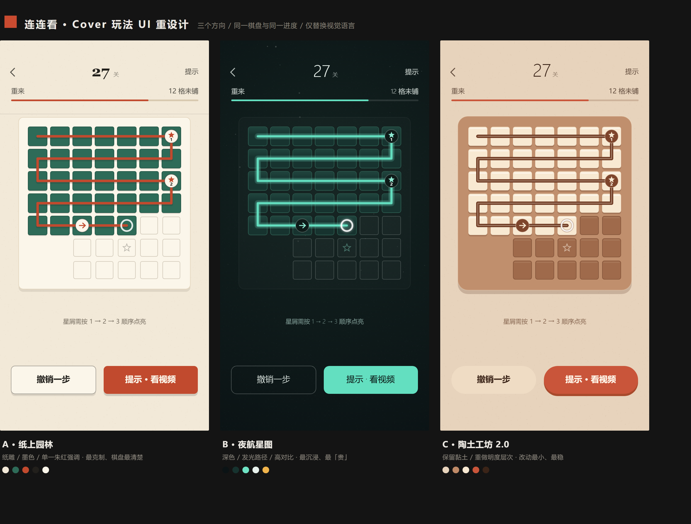
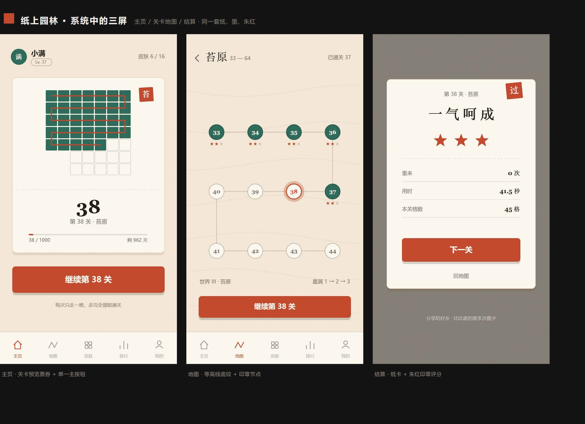

# 27 · UI 重设计方案（三方向 + 推荐落地）

> 触发：cover 棋盘重做后，用户仍判断「UI 不太好看」。
> 本文先给**可验证的病因**（都对应截图里的具体像素），再给三个方向与推荐方案的完整规范。
> 对比图：`风格样片/2026-11-09-三方向对比.png`、`风格样片/2026-11-09-纸上园林三屏.png`。
> 现状截图在 `games/line/out/shots/`（`live-home.png` / `cur-*.png` / `v2-705.png`）。
> 可交互原型：`/tools/ui-redesign.html`、`/tools/ui-redesign-a.html`（纯 Canvas，与最终实现同一条技术路线）。

---

## 0. 先说结论

**不是配色不好看，是「整屏没有明度差」。**
现在的界面从背景、卡片、按钮到棋盘，全部落在同一个米色区间（HSL 约 30°, 30–45%, 65–92%）：
- 眼睛找不到第一个落点；
- 所有元素都靠「投影 + 高光 + 描边」争取存在感，结果谁都不突出；
- 材质（黏土）被无差别地刷在每一个控件上，**材质的价值被稀释成噪声**。

推荐的解法不是换一套更漂亮的颜色，而是**重建三件事**：
1. **明度层级**：纸（浅）→ 墨（深）→ 朱红（唯一强调），全屏只允许一个高饱和色；
2. **材质纪律**：只有「按钮 / 关卡票券 / 结算法印」有厚度，其余全部是平的；
3. **字体分工**：数字与标题用衬线（有雕版感），正文用无衬线，靠字号与字距分层。

---

## 1. 诊断（6 条，均可对照截图）

### D1 满屏同明度，没有视觉落点
主页背景、票券、按钮、导航全部是米/奶油色，明度差 < 8%。
`out/shots/live-home.png` 里，玩家的视线会先落在**蓝色星球**上——而它只是装饰，不是可点区域。
真正的 CTA「开始游戏」反而融进背景。

### D2 黏土材质用得太满，失去强调能力
每个控件都有：外投影 + 内高光 + 顶部渐变 + 底部厚边。
当所有东西都「凸起」时，就没有东西是凸起的。
`cur-map.png` 里关卡节点、连线、返回键、关号胶囊是同一套厚度，主次完全平等。

### D3 地图页 60% 是空米色
`cur-map.png`：12 个节点浮在一大片空白上，没有世界身份、没有路线感、没有「我走到哪了」的叙事。
世界名「苔原 33–64」被压在关号胶囊下面，字号 12px，读不出来。

### D4 结算页信息错误 + 按钮堆叠
`cur-result.png`：
- 「步数 15 / 最短 14」——cover 模式步数恒等于格数−1，这个对比没有意义，而且 15>14 会让玩家以为自己打得很差；
- 页面上有 5 个按钮（下一关/分享/皮肤/返回大厅 + 顶部提示/跳过），三种颜色（鲑红/金黄/奶油），没有主次；
- 「关卡进度 3.7%」出现在结算页内部，和「通关」语义冲突。

### D5 关卡节点的数字与星级读不清
`cur-map.png`：深蓝节点上的 12px 白字、节点下方的三颗 8px 金星，在 375 宽的手机上等于噪点。
已完成 / 当前 / 未解锁三种状态只靠颜色区分，色弱玩家无法分辨。

### D6 棋盘「板」与「未走格」同色，进度读不出来
`v2-705.png`：底板是蓝灰色，未走格也是蓝灰色，只有 1px 更浅的线。
已走格是绿色圆角块，和橙色路径线互相抢；石障是深蓝块，看起来像洞；冰面几乎隐形。
**11×11 时玩家无法在 1 秒内判断「还剩哪几块」。**

---

## 2. 三个方向

| | A · 纸上园林 | B · 夜航星图 | C · 陶土工坊 2.0 |
|---|---|---|---|
| 关键词 | 纸雕 / 墨 / 单一朱红 | 深色 / 发光路径 / 高对比 | 保留黏土 / 重做明度 |
| 明度结构 | 浅底 + 深墨 + 朱红强调 | 深底 + 发光青 + 暖金 | 中底 + 奶油砖 + 赭红 |
| 棋盘可读性 | 最高（绿砖/纸白对比 5.6:1） | 高（路径自发光） | 中（砖与板差 3.2:1） |
| 制作成本 | 低（平面 + 细线） | 中（发光需 shadowBlur，微信慎用） | 中（保留现有厚度） |
| 风险 | 偏「文气」，不够热闹 | 深色在信息流里偏冷 | 改动最小，但可能仍「不够好看」 |
| 适合 | 想做差异化、长线口碑 | 想做高级感、夜间场景 | 想快速收尾、不折腾 |

**推荐 A**，理由：
1. 它是三者中**唯一同时解决 D1 与 D6** 的方案（明度层级 + 棋盘对比）；
2. 平面为主，绘制成本比现状更低，11×11 的每帧开销更小；
3. 朱红是唯一强调色，商店/广告/分享的 CTA 天然统一；
4. 和「一笔画 / 铺满」的东方气质契合，容易做出记忆点（印章、票券、等高线）。

B 作为**后续可选主题**保留：同一套布局与组件，只换 token（代码已按 token 取色，换肤成本低）。
C 作为**降级方案**：如果一周内必须上线，只做 C 也能解决 D1/D4/D5，但 D6 改善有限。

---

## 3. 推荐方案 A：纸上园林

### 3.1 设计哲学（一句话）

> **一张纸、一支笔、一方印。**
> 界面是纸，路径是笔迹，通关是盖章。除朱红印章外，一切都不许「跳出来」。

### 3.2 颜色 token

| token | 值 | 用途 | 对比度（对纸白） |
|---|---|---|---|
| `paper.bg` | `#F1E7D4` | 页面底 | — |
| `paper.card` | `#FCF7EC` | 票券 / 卡片 / 按钮底 | — |
| `paper.edge` | `#E3D3B8` | 卡片 1px 边 | — |
| `ink` | `#22201C` | 主文字 / 图标 | 12.6:1 |
| `ink.sub` | `#7A7164` | 次文字 / 说明 | 4.9:1 |
| `ink.hair` | `rgba(34,32,28,0.12)` | 分隔线 / 未走格 | — |
| `jade` | `#2E6B58` | 已走格 / 已完成节点 | 5.6:1 |
| `jade.deep` | `#245647` | 已走格描边 | — |
| `accent` | `#C14A2E` | 路径 / 主按钮 / 印章 | 4.6:1（大字合格） |
| `accent.soft` | `rgba(193,74,46,0.12)` | 当前节点光晕 / 选中底 | — |

规则：
- **每屏只允许一个 `accent` 面**（一个主按钮，或一个印章）；次级按钮一律描边。
- 金色只用于「星级 / 里程碑」，不用于按钮（现状把金色当第二主色，是主次混乱的来源）。
- 深色方案 B 只需替换上表的 6 个基色，布局与组件不变。

### 3.3 材质与形状

| 元素 | 做法 |
|---|---|
| 背景 | 纸底 + **5% 单色颗粒**（烘焙进离屏图，不逐帧画） |
| 卡片 / 票券 | 圆角 8，`paper.card` 填充，1px `paper.edge`，**只有整体一层 5px 偏移投影** |
| 主按钮 | 圆角 7，`accent` 填充，纸白字，下方 5px 实心偏移阴影；**无渐变、无高光、无描边** |
| 次级按钮 | 透明底 + 1.2px `ink` 40% 描边 |
| 已走格 | 玉色实心，圆角 3，1px `jade.deep` 边；**无投影** |
| 未走格 | 只画 1px `ink.hair` 线框；开局就是一张空白格纸 |
| 路径 | 4.5px 朱红，圆头圆角；下方 1px 深色偏移做「压痕」 |
| 当前格 | 3px 纸白圆环 + 1px 外圈朱红（浅色盘上必须双环才看得见） |
| 机制筹码 | 纸白圆盘 + 1.5px 墨边 + 单色墨绘符号；星屑编号在盘内下方 |
| 印章 | 朱红实心方，纸白反白字，旋转 −4°~−8°，只出现在「世界 / 通关」两个语义 |

### 3.4 字体

| 角色 | 字体 | 用法 |
|---|---|---|
| 展示（数字 / 标题） | `Songti SC`（iOS）/ `Noto Serif CJK`（Android）/ `SimSun`（Win） | 关卡号 40、结算标题 30、世界名 23 |
| 正文 | `PingFang SC` / `Microsoft YaHei` | 15 按钮、12 说明、10 角标 |
| 数据 | 衬线数字 | 「0 次」「41.5 秒」等，靠字距拉开 |

字号阶梯：**40 / 30 / 23 / 17 / 15 / 12 / 10**，不再出现 22、24、26、34 这些中间值。
Android 缺少衬线时自动回退无衬线，布局不依赖字体宽度（所有文本居中或右对齐），不会崩。

### 3.5 系统三屏

- **主页**：一张「关卡票券」。上半是 7×7 缩略棋盘（真实预览本关形状），中间是衬线大关号，下半是进度与单一主按钮。右上角是当前世界印章。
- **地图**：等高线底纹 + 一条墨线串起的节点。已完成＝玉色实心 + 三星；当前＝朱红双环；未解锁＝纸白 + 墨线。世界名与机制说明放在底部，不再塞进顶部胶囊。
- **结算**：一张纸卡，标题「一气呵成」用衬线拉开字距，三颗朱红星星，数据行用点线分隔，右下角盖「过」印。**只有一个主按钮**，分享/回地图降为文字链。

### 3.6 动效（少而准）

| 场景 | 动效 |
|---|---|
| 进入关卡 | 棋盘格线按行依次淡入（每行 30ms 延迟） |
| 画过一格 | 该格从纸白「刷」成玉色（120ms），路径线端点跟随手指 |
| 通关 | 三颗星依次盖章（每颗 90ms，带 1.04 倍回弹），随后「过」印落下 |
| 按钮按下 | 整体下移 2px，阴影同步缩短（模拟纸被按下去） |

不用粒子、不用光晕、不用弹簧。

### 3.7 插画与吉祥物：决定「可爱」的那一半

对比 `风格样片/C-黏土工坊.png` 与实际实现，最大的落差不是颜色，是**插画**：
参考图里有星球、小虫、花朵、印章，实现里只剩色块、圆角和投影。
所以这次重设计必须补三件**程序化插画**（Canvas 路径，不引入任何图片）：

| # | 资产 | 出现在哪 | 成本 |
|---|---|---|---|
| 1 | **七个世界徽记**（叶 / 溪石 / 苔 / 炉 / 井 / 云 / 星） | 主页票券角、地图世界条、结算页抬头 | 每个 30~40 行路径，共约 250 行 |
| 2 | **吉祥物改纸雕**：平涂身体 + 1.6px 墨线，保留触角、腮红、眨眼 | 主页票券下沿「探头」，与玩家对话 | 复用现有 `drawMascot`，只换画法 |
| 3 | **世界剪影**：山 / 石 / 苔 / 烟 / 井 / 云 / 星，单色 8% 透明度 | 地图页底部，一屏只露一层 | 每世界一条贝塞尔轮廓 |

纪律：
- 插画只出现在**非交互区域**，绝不压在文字或按钮上；
- 每屏最多一个主插画，避免又回到「满屏装饰」；
- 剪影与等高线都按「按需绘制一次 → 缓存」的方式做，不进每帧循环。

> 判断标准：把颜色全部抽掉、只看灰度，插画应该仍然给出**这屏是什么世界**的信息；
> 如果抽掉颜色就什么都不剩，那它只是装饰，不该画。

---

## 4. 实施计划

### P0 — 设计系统（1~2 天）

| # | 文件 | 改动 |
|---|---|---|
| 1 | 新增 `src/ui/ink.ts` | 颜色/字号/圆角 token，`paperBackdrop` `paperCard` `ruleButton` `sealStamp` `serifText` 五个原语 |
| 2 | `src/render/coverBoard.ts` | 已走格去投影改平涂；未走格改 1px 线框；筹码改纸白盘；路径改朱红 4.5px；当前格双环 |
| 3 | `src/ui/hud.ts` | 关号改衬线大字，去掉胶囊；进度改「38 / 86」+「剩 48」；结算页改成文档 §3.5 |
| 4 | `src/ui/nav.ts` | 5 个图标改成 1.6px 墨线单色，选中只换颜色，不加底块 |

### P1 — 逐屏替换（2~3 天）

| # | 文件 | 改动 |
|---|---|---|
| 5 | `src/ui/home.ts` | 票券式主页（关卡缩略图 + 衬线关号 + 单一 CTA） |
| 6 | `src/ui/mapview.ts` | 等高线底纹 + 新节点三态 + 底部世界条 |
| 7 | `src/ui/skins.ts` | 陈列柜改「纸卡网格」，色卡去投影，选中用朱红描边 + 印章「用」 |
| 7b | 新增 `src/ui/emblems.ts` | 七个世界徽记 + 剪纸吉祥物（§3.7），主页/地图/结算共用 |
| 8 | `src/ui/leaderboard.ts` / `profile.ts` / `friends.ts` / `share.ts` | 统一纸卡与墨线，去糖果色与发光 |

### P2 — 清理（1 天）

| # | 内容 |
|---|---|
| 9 | 删除 `ui/clay.ts` 与所有引用；`ui/theme.ts` 的糖果色只保留 B 主题所需部分 |
| 10 | 结算页数据行修正：cover 模式显示「重来 / 用时 / 格数」，**删掉「步数 / 最短」** |
| 11 | 埋点补 `ui_theme`，为后续 A/B 主题做准备 |

### 验收

1. 375×667 与 750×1334 两档截图，8 屏各一张；
2. 灰度化后仍能读出主次（主按钮/当前关/路径三处最亮或最暗）；
3. 11×11 棋盘上「已走 vs 未走」不看数字 1 秒可判；
4. `npm test` 全绿；新增 `ink.test.ts` 锁 token 对比度与字号阶梯。

---

## 5. 风险与对策

| 风险 | 对策 |
|---|---|
| Android 缺衬线字体 | 所有衬线只用于大字号展示；布局居中不依赖字宽；回退无衬线仍成立 |
| 深色主题的发光在微信上开销高 | B 主题的 `shadowBlur` 只在路径上，且限定 1 次绘制；实测掉帧再降级为双层描边 |
| 一次性替换 9 个 UI 文件风险大 | P0 先只改 token + 游戏内 + 结算，其余屏保留旧样式一天，分两次提交 |
| 用户不接受「文气」 | C 方案是同一套布局的暖色变体，换 token 即可回退，不需要重画 |

---

## 6. 这次用到的设计能力

| 能力 | 作用 |
|---|---|
| `frontend-design` skill | 方向选择、排版与色彩纪律、避免「AI 味」 |
| `canvas-design` skill | 纯 Canvas 构成与材质表达（无图片资源约束下的画法） |
| `design-critique` 的框架 | 按「层级 / 对比 / 一致性 / 可读性」四条做诊断，而不是凭感觉说丑 |
| `design-system` 的思路 | token 化、组件状态矩阵、验收可判定 |
| `ui-designer` 专家 | 可选的第二意见；本轮未调用，避免与当前角色重复 |

---

## 7. 待你拍板

1. **方向选 A / B / C**（推荐 A）。
2. **是否保留黏土作为可选皮肤**：保留则多一套 token，删除则代码更干净。
3. **结算页是否按新信息结构改**（重来/用时/格数，删掉步数与最短）——这条与视觉无关，是内容错误，建议无论选哪个方向都改。
